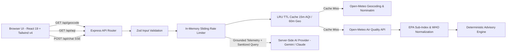

# Urban Air Quality Assistant


## Problem Statement

Help urban citizens understand real-time air quality, its health impact, and what actions to take, using live environmental data and Generative AI.

Raw air quality numbers (`27.4 µg/m³ PM2.5`, `AQI 84`) rarely tell people **what to actually do**—whether a morning run is safe, whether an asthma patient should wear an N95 mask, or when to open apartment windows.

## Solution Overview

The **Urban Air Quality Assistant** combines live Open-Meteo environmental telemetry, a deterministic rule-based health advisory engine, and a grounded streaming AI assistant inside a WCAG 2.2 AA accessible web application:

- **Global City Search & Geolocation**: Debounced city autocomplete (`AbortController` cancellation) plus optional browser GPS lookup with graceful fallback if permission is denied. No city is hardcoded.
- **Live Telemetry & Standards Comparison**: Current US AQI (2024 EPA PM2.5 breakpoints), European AQI, dominant pollutant, and 6-pollutant breakdown (`PM2.5`, `PM10`, `NO₂`, `O₃`, `SO₂`, `CO`) measured directly against **WHO 2021 Air Quality Guidelines** and **US EPA sub-indices**.
- **Color-Blind-Safe Classification**: Every AQI tier pairs a high-contrast surface/text palette with an explicit text label and distinct geometric symbol (`●`, `◐`, `▲`, `◆`, `⬢`, `✖`).
- **48-Hour Forecast (Chart + Accessible Table)**: Dynamically imported `Chart.js` visualization with 24h/48h horizon toggle, plain-text summary, and a full semantic `<table>` view.
- **Deterministic Health Advisory Engine**: Unit-tested, rule-based guidance tailored to 6 profiles (`General Public`, `Children & Families`, `Older Adults 65+`, `Asthma & Respiratory`, `Outdoor Workers`, `Endurance Athletes`), outputting mask guidance, exercise advice, indoor ventilation advice, and best/worst 3-hour outdoor windows.
- **Side-by-Side City Comparison**: Compare two independently searched cities across AQI, dominant pollutant, best outdoor window, and per-pollutant deltas.
- **Plain-Language Pollutant Explainers**: Accessible modal dialogs explaining what each pollutant is, urban sources, health impact, and regulatory benchmarks.
- **Grounded Streaming AI Assistant**: Server-side SSE chat grounded strictly in the active city's fetched telemetry and deterministic advisory output, with citation enforcement and prompt-injection defense.

## Architecture



## Tech Stack

- **Frontend**: React 19, TypeScript (strict mode), Tailwind CSS v4, Lucide Icons, Chart.js (dynamically imported)
- **Backend**: Express (`server.ts`) serving `/api/*` routes and Vite SPA middleware in dev / static assets in production
- **Data**: Open-Meteo Air Quality API & Open-Meteo Geocoding API (zero API key required), OpenStreetMap Nominatim reverse lookup
- **Gen AI**: Server-side `@google/genai` (`gemini-4-hydrogen`) streaming via SSE, with optional `AI_PROVIDER=anthropic` adapter for Anthropic Claude
- **Validation & Security**: `zod`, custom `fetchJsonWithRetry` with `AbortSignal` timeouts, sliding-window rate limiter, CSP & security headers
- **Testing & Quality**: Vitest, React Testing Library, `axe-core`, `@axe-core/playwright`, Playwright, ESLint, Prettier, GitHub Actions CI

## Setup & Local Development

1. **Install dependencies**:
   ```bash
   npm install --legacy-peer-deps
   ```
2. **Configure environment variables**:
   ```bash
   cp .env.example .env
   ```
   Edit `.env` and supply `GEMINI_API_KEY` (or set `AI_PROVIDER=anthropic` and `ANTHROPIC_API_KEY`).
3. **Start the full-stack development server** (port `3000`):
   ```bash
   npm run dev
   ```
4. **Build and run production bundle**:
   ```bash
   npm run build
   npm start
   ```

### Environment Variables

| Variable               | Required       | Default  | Description                                                |
| ---------------------- | -------------- | -------- | ---------------------------------------------------------- |
| `GEMINI_API_KEY`       | Yes (for chat) | —        | Server-side Gemini API key (`@google/genai`)               |
| `AI_PROVIDER`          | No             | `gemini` | `gemini` or `anthropic`                                    |
| `ANTHROPIC_API_KEY`    | No             | —        | Used when `AI_PROVIDER=anthropic`                          |
| `RATE_LIMIT_WINDOW_MS` | No             | `60000`  | Sliding window duration in ms                              |
| `RATE_LIMIT_AQI_MAX`   | No             | `60`     | Max `/api/aqi` & `/api/geocode` requests per IP per window |
| `RATE_LIMIT_CHAT_MAX`  | No             | `20`     | Max `/api/chat` requests per IP per window                 |

## Available Scripts & Testing

| Command                 | Purpose                                                        |
| ----------------------- | -------------------------------------------------------------- |
| `npm run dev`           | Start Express + Vite dev server on port 3000                   |
| `npm run build`         | Build production client bundle into `dist/`                    |
| `npm run lint`          | Run strict `tsc --noEmit` and ESLint                           |
| `npm run typecheck`     | Run TypeScript strict compiler check                           |
| `npm run format:check`  | Verify Prettier formatting                                     |
| `npm run test`          | Run unit, component, axe, and API route tests                  |
| `npm run test:coverage` | Run tests with V8 coverage thresholds (`>= 80%` on `src/lib/`) |
| `npm run test:e2e`      | Run Playwright smoke + full-page axe accessibility scan        |

Current `src/lib/` coverage (`npm run test:coverage`):

- **Lines**: `91.89%` (threshold `80%`)
- **Statements**: `90.46%` (threshold `80%`)
- **Functions**: `89.36%` (threshold `80%`)
- **Branches**: `78.07%` (threshold `75%`)

## API Documentation

### `GET /api/health`

Returns `{ "status": "ok", "timestamp": "..." }`.

### `GET /api/geocode?q=<city>` or `GET /api/geocode?lat=<lat>&lon=<lon>`

- Validates `q` (2–100 characters, sanitized character set) or WGS84 `lat`/`lon` via `zod`.
- Caches geocoding responses for **60 minutes** (`X-Cache: HIT|MISS`, `Cache-Control: public, max-age=3600`).

### `GET /api/aqi?lat=<lat>&lon=<lon>&name=<city>`

- Validates coordinates via `zod`, fetches current + 48-hour Open-Meteo air quality telemetry with timeouts and exponential backoff retries.
- Normalizes into EPA sub-indices, WHO guideline ratios, dominant pollutant, and 24-hour summary stats.
- Caches responses for **15 minutes** (`Cache-Control: public, max-age=600, stale-while-revalidate=300`).

### `POST /api/chat`

- Validates `message` (max 500 chars), `profile`, `history` (max 10 turns), and grounded `context` via `zod`.
- Streams Server-Sent Events (`event: delta`, `event: done`, `event: error`) capped at 2,400 output characters.

## Security Measures

- **Server-Side Secrets Only**: API keys live strictly in server environment variables; `.env*` is gitignored and `.env.example` documents templates.
- **All External Calls Proxied**: Client code only talks to `/api/*`; Open-Meteo and LLM endpoints are never called directly from the browser.
- **Input Validation & Rate Limiting**: Every query parameter and JSON body is validated with `zod`; sliding-window rate limits return `429` with `Retry-After` and `X-RateLimit-*` headers. (For multi-region serverless scale, swap `InMemoryRateLimiter` with Upstash Redis.)
- **Prompt-Injection Defense**: `src/lib/ai/grounding.ts` escapes `<`/`>` delimiters, strips control characters, wraps telemetry in `<grounded_telemetry>` and user text in `<user_query>`, and instructs the model to treat user input strictly as data.
- **No `dangerouslySetInnerHTML`**: Assistant responses render through `SafeMarkdown.tsx` using pure React elements.
- **Security Headers**: Express sets `Content-Security-Policy`, `X-Content-Type-Options: nosniff`, `Referrer-Policy: strict-origin-when-cross-origin`, and `Permissions-Policy: geolocation=(self)`.
- **Dependency Audit (`npm audit` & `npm audit --omit=dev`)**: **0 vulnerabilities found** across 340 audited packages.

## Accessibility Measures (WCAG 2.2 AA)

- Skip-to-content link (`#main-content`), semantic `<header>`, `<nav>`, `<main>`, `<footer>`, single `<h1>`, and logical heading hierarchy.
- Keyboard-accessible combobox (`ArrowUp`/`ArrowDown`/`Enter`/`Escape`), modal dialog (`Escape` to close), and visible `focus-visible` rings on all controls.
- `aria-live="polite"` regions announce AQI telemetry refreshes, profile advisory changes, and streaming assistant responses.
- Non-hue-only AQI status signaling (color + text label + EPA numeric range + unique symbol).
- Chart view pairs a plain-text summary with a toggleable semantic `<table>` view.
- Respects `prefers-reduced-motion` and `prefers-color-scheme` with an explicit Light/Dark toggle.
- Automated `axe-core` assertions run in component tests and Playwright E2E tests.

## Performance & Efficiency

- Server-side TTL caching (`15 min` AQI, `60 min` geocoding) eliminates redundant upstream calls.
- Debounced city search (`280ms`) + `AbortController` cancels stale requests on rapid typing or city switching.
- `Chart.js`, `CityCompareView`, and `AiAssistantPanel` are dynamically/lazily imported so the initial shell remains lightweight.

## Gen AI Usage & Prompt Design

Generative AI is used exclusively for the conversational Q&A panel (`src/lib/ai/grounding.ts` and `src/lib/ai/provider.ts`). All AQI math, WHO benchmark ratios, and health advisories are computed deterministically in `src/lib/aqi/` and `src/lib/advisory/`. The system instruction enforces:

1. Treating `<user_query>` strictly as untrusted data.
2. Citing exact numbers and units from `<grounded_telemetry>`.
3. Explicitly stating when requested data (e.g., pollen counts or >48h forecasts) is unavailable.
4. Avoiding medical diagnoses or prescriptions.

## Limitations & Future Work

- **Model-based vs. Station Sensors**: Open-Meteo CAMS provides global gridded air quality forecasts (~10–40 km resolution); integrating hyperlocal ground sensors (e.g., OpenAQ v3) as an optional secondary layer would improve street-level precision.
- **Multi-Instance Rate Limiting**: Replace the in-memory `InMemoryRateLimiter` with Upstash Redis when scaling horizontally across multiple serverless workers.
- **Offline PWA Support**: Cache the most recent city report in IndexedDB for low-connectivity commutes.
